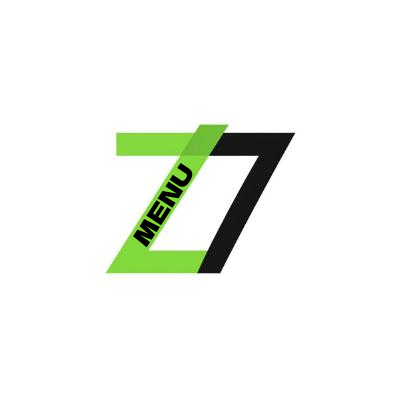

<div align="center">
   <a href="https://github.com/Z7PROJECT/ZMenu7">
      
   </a>
   <h1 align="center">ZMenu7</h1>
   <p align="center">A customizable mod menu for Geometry Dash.</p>
</div>

<div align="center">
    <a href="https://github.com/Z7PROJECT/ZMenu7">
      
    </a>
    
    <a href="LICENSE.md">
      
    </a>
    <a href="https://github.com/Z7PROJECT/ZMenu7/issues">
      
    </a>
    <a href="https://discord.gg/NnpwFRDMND">
      
    </a>
</div>

## Tabbed style


## Panel style


## Installation
1. Install [Geode](https://geode-sdk.org).
2. Open Geometry Dash and select the Geode button.
3. Open the Download tab and search for **ZMenu7**.
4. Open the mod page, select Download, and restart the game.

## Usage
- On PC, press `TAB` to open or close the menu.
- Enable or configure the features you want to use.
- For help, join the [Support Discord server](https://discord.gg/NnpwFRDMND).

## Features
- 90+ gameplay and utility features
- Start Position Switcher
- Customizable labels
- Trajectory display
- Death position markers
- Replay bot
- Configurable keybinds
- Customizable themes and layouts

## Build instructions
Requirements: CMake, MSVC or Clang, Git, Geode CLI, and the Geode SDK.

```bash
git clone https://github.com/Z7PROJECT/ZMenu7
cd ZMenu7
cmake -B build -DCMAKE_BUILD_TYPE=RelWithDebInfo
cmake --build build --config RelWithDebInfo
```

## Credits
Thanks to the developers whose work and contributions helped make this project possible:
- [ninXout](https://github.com/ninXout) — [Crystal Client](https://github.com/ninXout/Crystal-Client)
- [prevter](https://github.com/Prevter) — [OpenHack](https://github.com/Prevter/OpenHack)
- [maxnut](https://github.com/maxnut) — [GD Mega Overlay](https://github.com/maxnut/GDMegaOverlay)
- [Firee](https://github.com/FireMario211) — [Prism Menu](https://github.com/FireMario211/Prism-Menu)
- [SpaghettDev](https://github.com/SpaghettDev)

Thanks to all testers, contributors, and supporters.

## License
This project is distributed under the terms in [LICENSE.md](LICENSE.md) (CC0 1.0 Universal).
